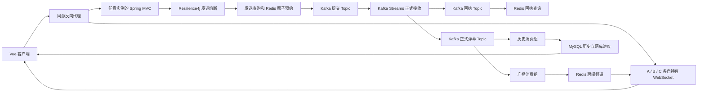

# 直播间弹幕 V2 设计

弹幕账号冷却和发送熔断由保护模块定义。三实例共用 Redis 账号冷却，每个实例各自维护发送熔断状态。 [业务规则与熔断范围](../../resilience/design.md) · [发布与切换](../../resilience/deployment-and-operations.md#发布与回退)

## 背景、目标与范围

V1 在 JVM 内完成弹幕受理、短期去重和本机广播。V2 由 Kafka 保存提交和正式弹幕，Redis Pub/Sub 转发实时事件，MySQL 提供历史查询。三实例中的任意实例都可以处理 HTTP 和 WebSocket。一个应用进程下线后，剩余实例接管分区。 [V1 设计](../design.md) · [部署与运行](deployment-and-operations.md)

三份相同的 Spring Boot 应用使用同源代理与共享 Kafka、Redis、MySQL。每份应用运行 MVC、WebSocket、Kafka Producer、Streams 和各消费组。接入和后台独立部署、Kafka 分区扩展、Redis Cluster、MySQL 历史分库分表留待后续阶段。

历史写入允许缺号和迟到补写。可判定的冲突只跳过单条，后续有效消息继续落库。同房间弹幕按序号排序，页面在实时消息到达后即可展示，并通过最近历史窗口补入迟到项。 [历史写入规则](database.md#历史写入和水位)

## 整体设计

| 参与方 | 职责 |
| --- | --- |
| Vue 房间页 | 管理发送草稿和异步回执，合并实时和历史弹幕，按房间序号展示当前可见消息。 |
| 同源反向代理 | 对外提供 Vue、`/api` 和 `/ws`，在可用实例间分配新请求和 WebSocket 握手。 |
| `liveflow-api` | 提供 Spring MVC 接口和 WebSocket，使用可信 JWT 身份，按房间管理连接和入队顺序，回传历史进度。 |
| `liveflow-core` | 维护输入校验、发送者显示名、正式接收与去重规则、历史查询及写入事务。业务依赖通过接口承接。 |
| `liveflow-infrastructure` | 适配 Kafka Producer、Streams 处理、Kafka 消费与确认、Redis Lua、房间频道和回执投影。 |
| Kafka | 保存提交、正式事件和终态回执。同一房间的提交按同一分区处理。 |
| Redis 与 JVM | Redis 保存鉴权状态、提交预约、短期回执并向当前订阅者广播。JVM 保存实际连接、有界队列和房间订阅关系。 |
| MySQL | 保存历史事件、房间最大落库序号及跨实例可读的处理阻断记录。用户资料、房间和鉴权数据沿用各自模块定义。 |

### 三实例间的分工

任意实例都可以签发和兑换 Ticket、提交弹幕及查询回执和历史。Kafka 在实例间分配后台任务；同一房间仍由一个提交分区维护顺序。实时广播消费组每条事件发布到 Redis 房间频道，各实例订阅有本机观众的频道，并向本机连接推送。代理无需为用户、房间或会话固定上游。一个用户可在 A 申请 Ticket、经 B 建立连接、向 C 发送弹幕。共享 Redis 保证一次性 Ticket 和全局账号冷却。 [接口设计](api.md) · [分区交接](event-contract.md#三实例分区交接与接入判断)

本机负责的分区数量只用于后台分工。新提交由目标分区状态及生产确认决定，回执由共享 Redis 决定，历史由已提交的 MySQL 快照及受影响范围的阻断记录决定。实例间共享短期运行状态与持久故障记录，供接入判断和接管恢复使用。 [Redis 运行状态](storage.md#三实例运行状态与定时任务) · [持久阻断记录](database.md#处理阻断记录)

Ticket 签发、WebSocket 兑票、发送和历史共用房间模块的存在性判断。缓存启用后，这些入口可以跨实例复用同一房间的查库结果。历史仍在 MySQL 快照内检查持久阻断并读取水位和消息页，回执按当前会话作用域直接查询业务 Redis。 [房间存在性缓存](../../room/storage.md) · [调用契约](api.md#房间存在性判定)

### Kafka 运行时拆分

拆分前，`RoomKafkaRuntime` 同时实现发送端口与 `SmartLifecycle`，持有生产者、Streams、三个消费组和维护任务。拆分后，`liveflow-infrastructure` 的弹幕包按下表组织，每个客户端由一个组件创建和关闭，各实例运行同一套组件。Kafka 多 Broker 与副本扩容作为后续阶段。 [生命周期协调器](../../../../backend/liveflow-infrastructure/src/main/java/com/liveflow/infrastructure/message/RoomKafkaRuntime.java)

| 组件 | 职责与依赖 |
| --- | --- |
| `RoomKafkaProducer` | 实现 `RoomMessagePorts.Producer` 的 `requireAdmission(roomId)` 和 `publish(submission)`。使用 `RoomAdmissionStatus` 检查目标分区，持有生产客户端、在途名额以及入队指标。Broker 确认完成后才完成成功结果。同步异常与异步回调通过同一完成信号归还名额，HTTP 等待超时不提前归还。 |
| `RoomKafkaStreamsRuntime` | 管理 `KafkaStreams`、`RoomAdmissionProbe`、实例状态目录和正式接收指标。通过 `RoomAdmissionStatus` 对外发布本机分区采样和退出状态。采样失败沿用现有快照新鲜度规则，任务异常沿用现有退出与接管策略。 |
| `RoomKafkaConsumerGroupRuntime` | 管理广播、历史、回执三个正式消费组。复用 `RoomKafkaConsumer` 的拉取、位点确认、暂停和退避机制。各组按自身职责确认 Redis 发布、MySQL 历史事务或 Redis 回执投影，保留各自的指标和阻断范围。 |
| `RoomKafkaMaintenanceScheduler` | 独立调度回执重建与历史清理，沿用各自的 Redis 租约。回执重建使用临时消费者和本轮捕获的分区末尾，完成时由租约持有者写恢复标记。正式回执组继续推进自己的位点。历史清理继续由 `RoomHistoryService` 分批处理。 |
| `RoomKafkaRuntime` | 保留为唯一的 Kafka 生命周期协调器。使用既有 `RoomMessageTopology` 创建或校验业务 Topic，并统一管理组件启停及部分启动失败后的清理。 |

发送服务继续经现有业务端口调用 Producer。分区准入检查在新预约之前执行。本机停写与后台运行分别受控，停写期间后台仍可处理已入队提交。历史组在数据库事务成功后提交消费位点，事务结果不明时按原位置恢复。维护任务按批确认租约和停止状态，临时客户端由本次任务关闭。 [生产和确认](event-contract.md#生产和确认) · [消费确认规则](event-contract.md#三个输出消费组) · [维护租约](storage.md#三实例运行状态与定时任务)

| 范围 | 本轮影响 |
| --- | --- |
| 对外接口 | 沿用 MVC、WebSocket 和 Vue 契约。接口路径、字段、错误码、发送状态和恢复行为均按现有定义。 [接口设计](api.md) |
| MySQL | 沿用 `room_messages`、`room_message_history_state` 与 `room_message_processing_blocks`。拆分只调整调用归属，部署无需 DDL、Flyway 迁移或回填。 [数据库设计](database.md) |
| Redis | 沿用广播频道、回执、分区准入状态和维护租约的 Key、TTL 与 Lua 操作。 [Redis 设计](storage.md) |
| Kafka | 沿用业务 Topic、6 个分区、事件结构、消费组、Streams 应用 ID、状态存储、已提交位点及副本配置。 [消息队列设计](event-contract.md) |
| 配置与指标 | 沿用现有配置项、默认值、指标名称和标签。指标由对应职责组件注册一次。 [运行参数](deployment-and-operations.md#初始参数) |

启动、停机和新版三实例检查见部署文档。 [Kafka 运行时拆分切换](deployment-and-operations.md#kafka-运行时拆分切换)

## 端到端流程

### 提交与正式接收

1. Vue 为一次发送固定正文和 `clientMessageId`，使用 Bearer 和 CSRF 规则发起一次 POST。后端规范化正文，先取得发送熔断许可，再读取已登记的提交、检查房间和账号、取得显示名。 [发送接口](api.md#发送弹幕) · [发送熔断](../../resilience/design.md#发送熔断)
2. Redis 原子绑定正文摘要，登记账号冷却并授予一次 Kafka 发布许可。同账号跨房间、标签页和会话共用两次新预约至少间隔 10 秒的规则。Broker 确认后返回 `202`，遇到确认不明时由页面提示未知并提供可用的回执查询。 [账号额度和提交绑定](storage.md#账号额度和提交绑定) · [生产和确认](event-contract.md#生产和确认)
3. Kafka Streams 按提交 Topic 的分区顺序裁决。同一会话、房间和客户端标识下，首个有效命令分配 `messageId`、`roomSeq` 和 `sentAt`，将正式事件、终态回执、去重状态和房间序号纳入同一 Kafka 事务。相同正文的后续命令取回原结果，异文生成冲突回执。 [正式接收和顺序](event-contract.md#正式接收和顺序)
4. Vue 通过回执接口确认正式接收。已提交的正文快照独立保存，用户可继续编辑下一条。消息列表通过 WebSocket 和历史查询更新。 [发送交互](api.md#发送交互) · [回执查询](api.md#查询提交回执)

### 广播与历史

1. 广播组按分区串行发布到 Redis 房间频道。实例在房间订阅就绪后将 `ready` 排入连接，再按房间事件顺序处理入队。连接独立写入，达到队列条数、字节数或等待时间上限时独立关闭。 [频道与订阅](storage.md#房间频道与订阅) · [连接资源](storage.md#jvm-连接资源)
2. 历史组独立读取正式事件，按分区批量提交 MySQL。有效事件可以跳号写入，保留期内的迟到记录可以补写。重复事件幂等跳过，键冲突保留先落库的记录并跳过本条。历史记录和最大落库序号同事务提交，随后才确认 Kafka 进度。广播组可以独立推进。 [历史写入与进度](database.md#历史写入和水位)
3. 历史与实时复用 `messageId`、`roomSeq`、`senderName`、`content` 和 `sentAt`。同一房间按 `roomSeq` 排序，`sentAt` 用于本地秒级展示。昵称变更影响后续新提交，正式事件保留当时显示名。 [弹幕字段](api.md#弹幕数据)

### 进房、断线与补拉

1. 申请一次性 Ticket 建立 WebSocket。收到 `ready` 后，实时帧立即进入列表，最近历史在后台读取。登录会话切换、换房和页面卸载时清理旧房间的请求和连接。 [WebSocket 协议](api.md#websocket-接收协议)
2. 页面已展示 100 时收到 103，可以立刻展示 103。101 迟到时，通过实时帧或下次历史窗口刷新插入对应位置，前提是仍在最近 100 条内。同一序号只展示一条，已有持久记录可纠正页面上的冲突项。
3. 重连、Redis 重新订阅或需要追上更高落库序号时刷新最近 100 条。前端合并刷新触发，保持实时列表和正在阅读的位置。序号缺口不会延迟展示或持续触发查询。 [历史接口](api.md#查询历史) · [合并与恢复](api.md#前端合并与恢复)

## 异常、并发与恢复

| 场景 | 系统行为 |
| --- | --- |
| 发送熔断或半开名额已满 | 发送入口提前返回 `503`。回执、历史和 WebSocket 接收各自按依赖状态处理。 |
| 发送超时，Kafka 可能已经写入 | 显示结果未知。有预约 ID 时只读查询。Kafka 和 Redis 按原预约处理随后到达的结果。 |
| Redis 发布成功后广播进程退出 | Kafka 可能再次投递同一正式事件。事件标识和序号保持一致，浏览器只显示一次。 |
| Redis 订阅中断或连接过慢 | 受影响连接重新同步。历史保存仍由独立的消费组推进。 |
| MySQL 写入后消费者退出 | Kafka 可能重放该批。历史唯一键和不可变字段比较保证已落库记录保持原值。 |
| 历史消费积压或暂时缺号 | 历史接口返回当前已有的记录，实时列表独立推进。 |
| 单条历史数据发生冲突 | 保留已有历史，记录本条冲突。同一房间后续弹幕及同分区其他房间继续落库。 |
| 单个应用实例下线 | 其余实例继续接入。Kafka 重新分配任务，受影响的观众申请新 Ticket 重连并刷新最近窗口。 |
| 目标分区交接或故障 | 允许正常交接期间的短时入队。持续失去正式处理能力时暂停对应范围的新提交。历史分区已确定位点越界或存在不可恢复的处理错误时，阻断该分区的历史读取和推进。 |
| 同一房间成为热点 | 网关按房间调度，按连接隔离慢消费者。入口有界控制在途请求，按容量拒绝新的提交。 |

## 专业文档

| 内容 | 定义 |
| --- | --- |
| HTTP、回执、WebSocket、历史补拉和前端合并 | [接口设计](api.md) |
| MySQL 表、索引、事务、历史分页与保留 | [数据库设计](database.md) |
| Kafka Topic、事件结构、事务、消费与顺序 | [消息队列设计](event-contract.md) |
| Redis Key、TTL、Lua、Pub/Sub 与连接队列 | [Redis 与本机状态设计](storage.md) |
| 本地拓扑、参数、容量、发布和故障处置 | [部署与运行设计](deployment-and-operations.md) |
