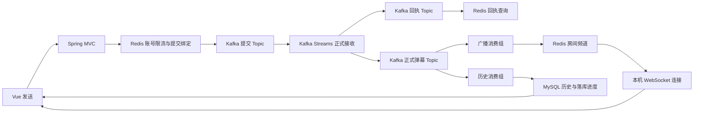

# 直播间弹幕 V2 设计

## 背景、目标与范围

当前 V1 在 JVM 内完成弹幕受理、短期去重和本机广播，进程退出后无法恢复消息。V2 采用方案 B。Kafka 保存提交和正式弹幕，Redis Pub/Sub 转发实时事件，MySQL 提供历史查询。首轮在一个 LiveFlow 进程中运行完整链路，HTTP、Kafka 消费和 WebSocket 仍与现有部署单元一致。按房间的消息路由允许后续增加应用实例。 [当前 V1 设计](../design.md) · [部署与运行](deployment-and-operations.md)

本轮覆盖纯文本发送、异步回执、房间内有序广播、历史持久化和断线补拉。画面滚动弹幕、在线人数、超大房间实时采样和多应用实例部署留待后续讨论。

## 整体设计

| 参与方 | 职责 |
| --- | --- |
| Vue 房间页 | 管理发送草稿和异步回执，合并实时和历史弹幕，按连续房间序号展示。 |
| `liveflow-api` | 提供 Spring MVC 接口和 WebSocket，使用可信 JWT 身份，按房间管理连接和入队顺序，回传历史进度。 |
| `liveflow-core` | 维护输入校验、发送者显示名、正式接收与去重规则、历史查询及写入事务。业务依赖通过接口承接。 |
| `liveflow-infrastructure` | 适配 Kafka Producer、Streams 处理、Kafka 消费与确认、Redis Lua、房间频道和回执投影。 |
| Kafka | 保存提交、正式事件和终态回执。同一房间的提交按同一分区处理。 |
| Redis 与 JVM | Redis 保存鉴权状态、提交预约、短期回执并向当前订阅者广播。JVM 保存实际连接、有界队列和房间订阅关系。 |
| MySQL | 保存历史事件和已连续落库的水位。用户资料、房间和鉴权数据沿用各自模块定义。 |

## 端到端流程

### 提交与正式接收

1. Vue 固定正文和 `clientMessageId`，使用现有 Bearer 和 CSRF 规则发起 POST。后端规范化正文，从可信身份读取发送者显示名，检查房间和账号。发送额度仍为每账号 10 秒 5 条，统计各房间和标签页首次获得入队许可的提交。 [发送接口](api.md#发送弹幕) · [账号额度和提交绑定](storage.md#账号额度和提交绑定)
2. Redis 原子绑定同一提交的正文摘要，登记一次额度，授予短期发送租约。后端收到 Kafka 提交 Topic 的确认后返回 `202`。若确认不明，页面保留原请求并按同一标识重试。重复提交沿用额度和提交绑定。 [确认规则](event-contract.md#生产和确认)
3. Kafka Streams 按提交 Topic 的分区顺序裁决。同一会话、房间和客户端标识下，首个有效命令分配 `messageId`、`roomSeq` 和 `sentAt`，将正式事件、终态回执、去重状态和房间序号纳入同一 Kafka 事务。相同正文的后续命令取回原结果，异文生成冲突回执。 [正式接收和顺序](event-contract.md#正式接收和顺序)
4. Vue 通过回执接口确认正式接收。只有确认成功才清理与该提交对应的草稿。回执表示发送结果，消息列表通过 WebSocket 与历史查询更新。正在等待回执时，页面保留独立的提交快照，用户可继续编辑下一条。 [回执查询](api.md#查询提交回执)

### 广播与历史

1. 广播组按分区串行发布到 Redis 房间频道。实例在房间订阅就绪后将 `ready` 排入连接，再按房间事件顺序处理入队。连接独立写入，达到队列条数、字节数或等待时间上限时独立关闭。 [频道与订阅](storage.md#房间频道与订阅) · [连接资源](storage.md#jvm-连接资源)
2. 历史组独立读取正式事件，按分区批量提交 MySQL。历史记录与该房间的连续落库水位同时写入，写入成功后才提交该分区消费进度。一个数据库故障可能延迟历史读到最新事件，广播组可以独立推进。 [历史写入与进度](database.md#历史写入和水位)
3. 历史与实时复用 `messageId`、`roomSeq`、`senderName`、`content` 和 `sentAt`。同一房间按 `roomSeq` 排序，`sentAt` 用于本地秒级展示。昵称变更影响后续新提交，正式事件保留当时显示名。 [弹幕字段](api.md#弹幕数据)

### 进房、断线与补拉

1. 先申请一次性 Ticket，建立 WebSocket 并开始缓冲实时消息。首次进房读取最新历史窗口，以历史连续水位建立起点。重连保留当前房间和会话的最后连续序号。登录会话切换、换房和页面卸载时清理旧房间的回执查询、缓冲与重连任务。 [WebSocket 协议](api.md#websocket-接收协议)
2. 若连续游标为 40、实时缓冲中先收到 42，按 `afterSeq=40&throughSeq=41` 读取历史。历史暂未写到 41 时保留 40。得到 41 后按 41、42 展示，随后推进游标。合并时丢弃已经处理的序号；同一序号对应不同消息时触发重新同步并记录异常。
3. Redis 订阅恢复和历史水位前进时，网关发送控制帧驱动补拉，即使丢失的是房间最后一条弹幕。前端限制补拉并发、缓冲大小和轮询频率。超出历史保留窗口或客户端缓冲上限时，提示用户并重新读取最近窗口。列表仍保留最近 100 条，沿用底部跟随与向上阅读时保留位置的交互。 [历史接口](api.md#查询历史) · [恢复与缓冲](api.md#前端合并与恢复)

## 异常、并发与恢复

| 场景 | 系统行为 |
| --- | --- |
| 发送超时，Kafka 可能已经写入 | 明确提示结果未知。相同提交在约定窗口内重试时命中原绑定和正式去重。 |
| Redis 发布成功后广播进程退出 | Kafka 可能再次投递同一正式事件。事件标识和序号保持一致，浏览器只显示一次。 |
| Redis 订阅中断或连接过慢 | 受影响连接重新同步。历史保存仍由独立的消费组推进。 |
| MySQL 写入后消费者退出 | Kafka 可能重放该批。历史唯一键和连续进度校验保证重复写入得到相同结果。 |
| 历史消费积压 | 实时消息仍可到达。出现缺口时客户端在连续水位后补拉；水位追平后再继续。 |
| 同一房间成为热点 | 网关按房间调度，按连接隔离慢消费者。入口有界控制在途请求，按容量拒绝新的提交。 |

## 专业文档

| 内容 | 定义 |
| --- | --- |
| HTTP、回执、WebSocket、历史补拉和前端合并 | [接口设计](api.md) |
| MySQL 表、索引、事务、历史分页与保留 | [数据库设计](database.md) |
| Kafka Topic、事件结构、事务、消费与顺序 | [消息队列设计](event-contract.md) |
| Redis Key、TTL、Lua、Pub/Sub 与连接队列 | [Redis 与本机状态设计](storage.md) |
| 本地拓扑、参数、容量、发布和故障处置 | [部署与运行设计](deployment-and-operations.md) |
